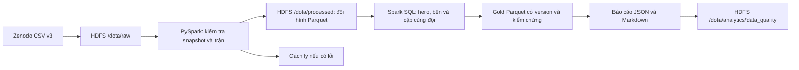

# Dota 2 Big Data — HDFS và Spark

Đồ án cá nhân môn Thực hành Big Data: xây dựng nền tảng phân tích đội hình và
dự đoán xác suất thắng của hai đội Radiant/Dire trước trận.

**Đã hoàn thành:** nạp dữ liệu HDFS, chuẩn hóa đội hình và phân tích hero/cặp
hero bằng Spark SQL. Mô hình ML, website, Kafka và Airflow thuộc lộ trình
tiếp theo; repo hiện chưa triển khai các chức năng đó.

## Kết quả đã kiểm chứng

| Hạng mục | Kết quả |
|---|---|
| Nguồn | [Zenodo v3 — Professional Dota 2](https://zenodo.org/records/23166182) |
| CSV nguồn | 223.002.035 byte, 48 cột, 1.007.768 snapshot |
| Trận riêng biệt | 90.530 |
| HDFS | 1 NameNode + 3 DataNode, block 64 MiB, replication 2 |
| Kiểm chứng lưu trữ | 4 block, 8 replica; HEALTHY; SHA-256 khớp nguồn |
| Bảng đội hình | 90.530 trận hợp lệ, 2 file Parquet Snappy |
| Lỗi phát hiện ở bước 2 | 0 dòng trùng, 0 snapshot lỗi, 0 trận mâu thuẫn |
| Thời gian xử lý bước 2 | Khoảng 114 giây trên môi trường WSL đã ghi nhận |
| Gold bước 3 | 127 hero, 254 dòng hero theo bên, 7.996 cặp cùng đội |

Xem [kết quả HDFS](evidence/hdfs/RESULTS.md) và
[báo cáo chất lượng dữ liệu](evidence/step2/report.md).
[Báo cáo phân tích Gold](evidence/step3/step3-20261026-v2/report.md) có các
bảng top 20 và so sánh năm hero được chọn nhiều nhất.
Đây là kết quả chạy thật trên WSL; GitHub Actions chỉ chạy kiểm thử quy tắc
bằng dữ liệu nhỏ, không tái tạo toàn bộ cụm HDFS hoặc xử lý CSV 223 MB.

## Luồng dữ liệu hiện tại



Một snapshot là trạng thái tại một phút trong trận. Pipeline xác nhận đội hình
và kết quả nhất quán rồi mới gom thành một dòng mỗi trận. Bảng đầu ra chỉ có
`match_id`, `radiant_heroes`, `dire_heroes`, `radiant_win`.

## Cấu trúc repo

```text
configs/hdfs-wsl.json          Cấu hình đường dẫn và user WSL
analytics/                    Spark SQL tạo bảng Gold và báo cáo đội hình
data/reference/                Manifest nguồn và schema, không chứa CSV lớn
docs/                         Hướng dẫn HDFS, chuẩn hóa và cách tổ chức dự án
evidence/hdfs/                Bằng chứng lưu trữ, checksum và chịu lỗi tiến trình
evidence/step2/               Báo cáo chuẩn hóa, mẫu trận và kết quả kiểm thử
evidence/step3/               Thống kê Gold, fixture tests và kiểm chứng
pipeline/                     Spark job chuẩn hóa dữ liệu
scripts/                      Quản lý HDFS, bridge WSL và lệnh kiểm thử
tests/                        Fixture và kiểm thử quy tắc chuẩn hóa
.github/workflows/            Kiểm thử Spark trên GitHub Actions
start-hadoop.ps1              Bật cụm HDFS
stop-hadoop.ps1               Tắt cụm HDFS, giữ nguyên dữ liệu
run-step2.ps1                 Chạy chuẩn hóa từ PowerShell
run-step3.ps1                 Chạy phân tích Spark SQL từ Silver
```

## Chạy trên máy hiện có

Môi trường đã kiểm chứng: Windows + Ubuntu WSL2, Hadoop 3.5.0, Java 17,
PySpark 4.2.0, Python 3.14.4, WSL khoảng 5,6 GiB RAM. Hadoop/PySpark cần được
cài sẵn. Repo không tự cài Hadoop hoặc khởi tạo máy WSL mới.

1. Kiểm tra `configs/hdfs-wsl.json`: user, thư mục Hadoop/Java/Spark và cụm HDFS.
2. Mở PowerShell tại thư mục repo:

```powershell
cd D:\BigDataTH_Project\Dota2_BigData
.\start-hadoop.ps1
```

Giao diện quản trị: [http://localhost:9870](http://localhost:9870).

Trên máy hiện tại, CSV và Parquet v1 đã nằm trong HDFS. Chuyển folder repo
không di chuyển block hoặc metadata trong `/home/danh/dota-hdfs`.

```powershell
# Chạy lại vào tên output mới; mặc định chặn ghi đè v1 đã tồn tại.
.\run-step2.ps1 -OutputPath hdfs://localhost:9000/dota/processed/match_drafts_v2

# Phân tích Silver v1, tự tạo run ID mới (ngưỡng hero/cặp mặc định 100).
.\run-step3.ps1

# Kiểm thử bằng fixture nhỏ, không ghi bảng HDFS.
.\scripts\run-tests.ps1

# Dừng riêng cụm HDFS Dota khi không dùng.
.\stop-hadoop.ps1
```

Nếu PowerShell chặn script, dùng `powershell.exe -NoProfile -ExecutionPolicy
Bypass -File .\start-hadoop.ps1` hoặc thay tên script cần chạy.

Với máy mới, đọc [hướng dẫn HDFS](docs/HDFS_CONFIGURATION.md): tạo cấu hình
riêng bằng `hdfs_lab.py setup`, start, download, ingest, verify; sau đó chạy
`run-step2.ps1`. Không format lại NameNode đã có metadata.

Chi tiết: [chuẩn hóa bằng Spark](docs/STEP2_DATA_PREPARATION.md).
Phân tích: [hướng dẫn bước 3](docs/STEP3_DRAFT_ANALYTICS.md). Chỉ tiêu thụ run
Gold có `_COMPLETED`; các run `_INVALIDATED` hoặc chưa hoàn tất không dùng
cho dashboard.

## Dữ liệu và bằng chứng trên GitHub

- CSV nguồn và Parquet nằm trong WSL/HDFS, không commit vào Git.
- `data/reference/source_manifest.json` là metadata đầu vào mà pipeline đọc;
  nó không phụ thuộc thư mục bằng chứng có được tái tạo hay không.
- Giữ JSON/Markdown/TXT nhỏ trong `evidence` để giảng viên xem kết quả.
- Bỏ qua log, cache, dump chẩn đoán và file tải dở bằng `.gitignore`.
- Báo cáo lịch sử có thể chứa đường dẫn thư mục trước khi repo được sắp xếp;
  các hướng dẫn vận hành đã được cập nhật theo folder mới.

## Lộ trình tiếp theo

Đã chuyển cách tiếp cận từ tài liệu Premier League sang
[kế hoạch phân tích Dota 2](docs/DOTA2_ANALYSIS_PLAN.md): câu hỏi, mẫu số,
ngưỡng mẫu, bốn bảng Gold, version và kiểm chứng. Bước 3 đã triển khai; kết
quả thật nằm trong báo cáo Gold liên kết ở trên.

1. ML: mã hóa đội hình, baseline và Logistic Regression.
2. Website tương tác chọn 10 hero và đọc thống kê Gold.
3. Kafka replay + Structured Streaming, rồi Airflow nếu cần cho môn học.

Dữ liệu trải nhiều patch và chỉ đến tháng 3/2026. Không dùng các biến trong
trận cho mô hình dự đoán trước trận; nguồn hiện không có patch/start_time.
Ba DataNode cùng WSL chỉ mô phỏng phân tán và lỗi tiến trình trên một máy.

## Tham khảo tổ chức

Tham khảo cách tách pipeline, script WSL, cấu hình, tests và CI từ
[chicago-crime-bigdata-analysis](https://github.com/DuyLinh0212/chicago-crime-bigdata-analysis).
Xem [giải thích cấu trúc và khác biệt](docs/PROJECT_STRUCTURE.md).
Giấy phép MIT trong repo áp dụng cho mã nguồn dự án; dataset lấy từ nguồn Zenodo.
