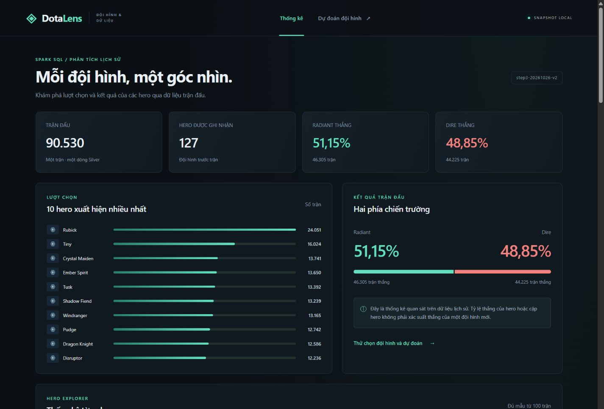
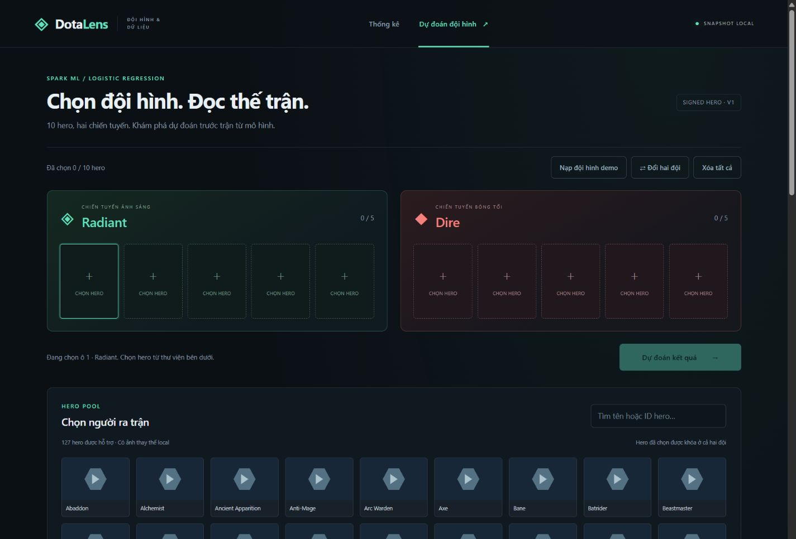

# Bước 5 — Website DotaLens

Website tiếng Việt chạy local bằng FastAPI + Uvicorn, HTML/CSS/JavaScript thuần.
Hai màn hình: thống kê Gold và chọn 10 hero để dự đoán bằng bundle bước 4.
Không build frontend; chạy website không cần Node.js, Spark, Java hoặc HDFS.
Bridge PowerShell vẫn dùng Ubuntu WSL và Python trong cấu hình của repo.

## Chạy ngay trên máy hiện tại

Snapshot `web-demo-v1` đã được xuất và kiểm chứng từ dữ liệu thật:

```powershell
cd D:\BigDataTH_Project\Dota2_BigData
.\start-web.ps1 -SnapshotId web-demo-v1
```

Mở [http://localhost:8000](http://localhost:8000). Script chạy foreground;
`Ctrl+C` dừng website. Dùng `-Port 8001` nếu cổng mặc định đang bận.
Server chỉ bind `127.0.0.1` trong WSL, không triển khai Internet.
HDFS đã được dừng sau phép thử độc lập; bật lại khi cần chạy Spark job.

Lần đầu, script tạo `.venv-web` và cài `requirements-web.txt` nếu chưa có venv.
Giai đoạn cài dependency cần Internet; khi đã chuẩn bị xong thì không cần.
Các bản đã kiểm chứng: FastAPI 0.142.2, Uvicorn 0.54.0, HTTPX 0.28.1 cho tests.

Snapshot, bundle và ảnh tải về nằm trong `artifacts/`, không được push Git.
Clone repo trên máy khác cần dựng HDFS/dữ liệu bước 1–4 rồi chuẩn bị snapshot;
ảnh chụp và báo cáo GitHub không thay thế artifact chạy website.

## Chuẩn bị snapshot mới

```powershell
.\start-hadoop.ps1
.\export-web-snapshot.ps1 -GoldRunId step3-20261026-v2 `
  -ModelRunId step4-20261027-v1 -SnapshotId web-demo-v2
.\start-web.ps1 -SnapshotId web-demo-v2
```

Không truyền `SnapshotId` thì exporter tự tạo ID từ UTC và hậu tố ngẫu nhiên.
Không ghi đè snapshot cũ. Nếu job lỗi, giữ thư mục để chẩn đoán và chọn ID mới.

Exporter Spark dùng `local[2]`, driver 1g, shuffle partitions 8. Nó kiểm tra
marker hai run, metadata một dòng, fingerprint nguồn và checksum bundle.
Đọc lại Silver, tái tạo các bảng kỳ vọng bằng logic bước 3 và so sánh Gold theo
khóa/schema/giá trị; sau đó xuất và đọc lại JSON, sai số tỷ lệ tối đa `1e-9`.
Quá trình này kiểm chứng dữ liệu phục vụ, không huấn luyện lại ML.

```text
artifacts/web/<snapshot_id>/
├── manifest.json          Run nguồn, fingerprint, inventory SHA-256, tình trạng ảnh
├── dashboard.json         Bốn bảng Gold và ngưỡng mẫu
├── heroes.json            ID, tên, ảnh local, trạng thái model hỗ trợ
├── hero_metadata.json     Snapshot nguồn OpenDota
├── model_bundle.json      Portable inference, không có route tải công khai
├── model_metrics.json     Metrics bước 4
├── images/                PNG cache và SVG thay thế local
└── _COMPLETED             Chỉ xuất hiện sau kiểm chứng
```

Metadata lấy từ [OpenDota dotaconstants](https://github.com/odota/dotaconstants),
ghim revision và SHA-256 trong manifest. Tên/ảnh phục vụ hiển thị;
không thêm chỉ số hero của meta hiện tại vào vector ML.
Ảnh dùng đường dẫn `img` của OpenDota trên CDN Steam; mỗi hero thử tối đa ba
lần qua Cloudflare/Akamai/Fastly, timeout 8 giây/lần, tối đa tám luồng tải.
Ảnh không tải được dùng placeholder và được ghi nhận theo hero.

## Kết quả thực tế ngày 27/10/2026

| Hạng mục | Kết quả |
|---|---:|
| Snapshot | `web-demo-v1` |
| Gold / model | `step3-20261026-v2` / `step4-20261027-v1` |
| Trận trong Gold | 90.530 |
| Hero / dòng theo bên / cặp | 127 / 254 / 7.996 |
| Cặp đủ ngưỡng 100 trận | 5.611 |
| Tên hero được đối chiếu | 127 |
| Ảnh Steam tải thành công / ảnh thay thế | 0 / 127 |
| Thời gian export và tải metadata/ảnh | 109,33 giây |
| Parity API so với bundle | 26 đội hình, khớp hoàn toàn |
| Route ảnh local đã kiểm tra | 127 / 127 trả HTTP 200 |

CDN Steam đã đóng kết nối TLS ở môi trường kiểm tra. Vì vậy bản demo hiện có
đầy đủ tên hero nhưng dùng ảnh thay thế; không tuyên bố đã có 127 ảnh hero thật.
Khi CDN truy cập được, chạy prepare với ID mới để tạo snapshot có ảnh cache.

Đội hình demo `7,38,48,85,106` đối đầu `11,86,123,128,136` cho Radiant
49,72205722046468%, Dire 50,27794277953532%, chọn Dire, khớp CLI bước 4.
Đổi hai đội cho Radiant khoảng 52,11%; không ép hai dự đoán đối xứng vì có intercept.
Test accuracy của mô hình 54,49%, baseline 51,23%, ROC-AUC 0,5589.
F1 Radiant 0,5768 thấp hơn baseline 0,6775; đây không phải cải thiện mọi chỉ số.

## API và giao diện

| Route | Kết quả |
|---|---|
| `GET /health` | Ready, snapshot ID, Gold/model run ID |
| `GET /api/heroes` | ID, tên, URL ảnh local, cờ hỗ trợ |
| `GET /api/dashboard` | Toàn bộ bảng Gold nhỏ, ngưỡng mẫu, metrics, run ID |
| `POST /api/predict` | `radiant_heroes`, `dire_heroes`; kết quả như CLI |

API dùng `StrictInt`, mỗi bên năm hero, từ chối boolean/float/chuỗi,
ID âm, trùng hoặc ngoài mapping bằng HTTP 422. Dự đoán gọi trực tiếp
`ml.predict_draft.predict`; `p_radiant > 0.5` chọn Radiant, còn lại Dire.
Bundle được nạp một lần; không phục vụ thư mục snapshot hoặc model cho browser.

Thống kê có top lượt chọn, tìm tên/ID, xếp hạng xác định, phân trang 20 dòng,
bộ lọc hero cho cặp và so sánh hai bên. Dòng thiếu mẫu vẫn nằm trong JSON;
mặc định xếp hạng dùng mẫu đủ, có checkbox xem các dòng còn lại.
Chỉ coi so sánh hai bên đủ mẫu khi cả hai đều đạt ngưỡng.
Không có quan sát hiển thị “Chưa có dữ liệu”; chênh lệch baseline là điểm phần trăm.

Draft có năm ô mỗi đội, tìm hero, khóa hero đã chọn, xóa từng ô/toàn bộ,
đổi đội và nạp demo. Khi sửa đội hình xóa kết quả cũ; trong lúc gửi request
khóa thao tác sửa và nút dự đoán. Website luôn ghi giới hạn dữ liệu lịch sử.

## Kiểm thử và bằng chứng

```powershell
# Toàn bộ fixture Spark + API; không cần HDFS.
.\scripts\run-tests.ps1

# Sau khi có snapshot: kiểm chứng web thật, trong khi HDFS đang dừng.
wsl -d Ubuntu -u danh --cd /mnt/d/BigDataTH_Project/Dota2_BigData `
  --exec .venv-web/bin/python scripts/verify_web_snapshot.py `
  --snapshot-id web-demo-v1 --require-hdfs-down
```

Exporter fixture kiểm tra keyed parity, marker nguồn, fingerprint/checksum,
chống ghi đè, retry/fallback và run lỗi không có marker hoàn tất.
API có năm nhóm unittest: input lỗi, parity/thứ tự/đổi bên, threshold, route riêng
tư và assets local. TestClient dùng HTTPX; không cần dataset hoặc model thật.
Unit test JavaScript kiểm tra thứ tự khi bằng chỉ số, lọc mẫu, pagination và
10 hero khác nhau. Node chỉ dùng cho unit check tùy chọn local và trên CI,
không dùng để build hoặc chạy website. Script bỏ qua check này nếu máy không có Node.

CI chạy fixtures và lưu JSON kiểm thử; không tải CDN hoặc kết nối HDFS.
Kiểm chứng thực tế lưu trong [evidence bước 5](../evidence/step5/web-demo-v1/):
export, runtime, ảnh theo hero, thao tác trình duyệt desktop/mobile và bốn PNG.
Trong phép thử runtime, cổng HDFS 9000 được xác nhận đã tắt và mọi kết nối socket
bị chặn trong tiến trình kiểm thử. Cấu hình mạng của Windows/WSL không bị thay đổi.



