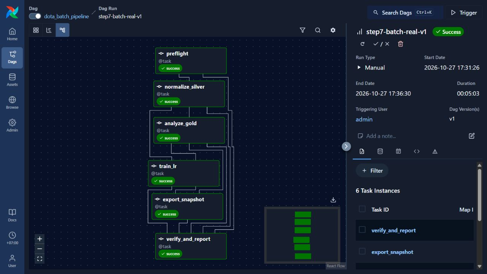
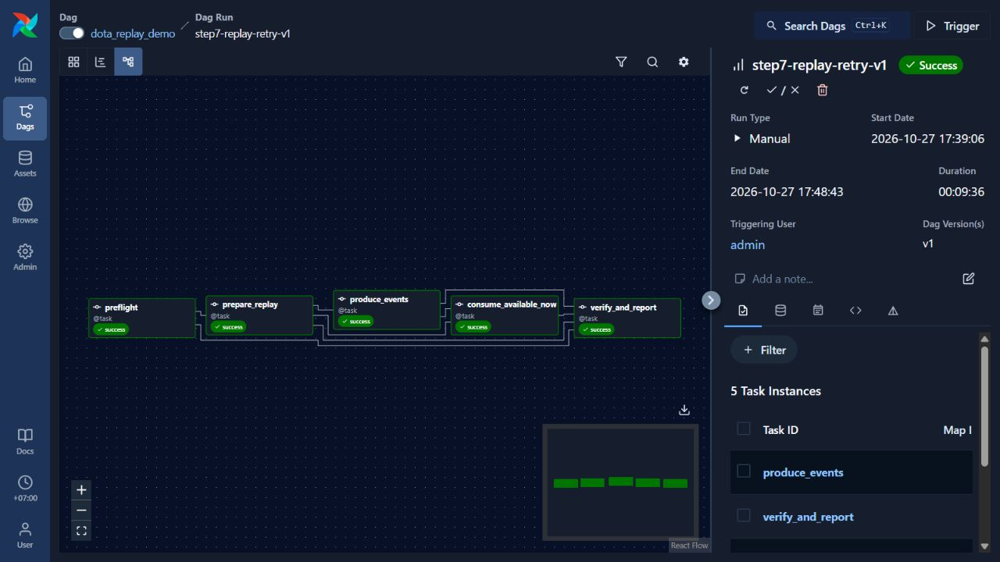

# Bước 7 — Kết quả Airflow trên dữ liệu thật

Kiểm chứng ngày **27/10/2026**, WSL Ubuntu, user `danh`. Các run bên dưới được
thực hiện trước khi commit bước 7, tại Git HEAD
`7c1a24debc6c1b379e7926e7e732c160e873c00d` của bước 6. Các trường Git và trạng
thái chưa commit/push trong evidence ghi nhận thời điểm nghiệm thu đó. Mã nguồn
và evidence nhỏ được công bố theo các commit riêng; dataset/model vẫn ở local/HDFS.

## Môi trường đã chạy

Airflow **3.3.2**, Python **3.14.4**, SQLite **3.46.1/WAL**, LocalExecutor.
Venv riêng `/home/danh/dota-airflow/venv`, metadata trên filesystem Linux.
Global parallelism 1; DAG chỉ chạy thủ công; pool Spark một slot.
Spark vẫn dùng Python hệ thống, Java 17, local[2], driver 1 GiB.

Constraints SHA-256:
`3635795a3021f4fadfc22b78cf5e4e0d2f4d345f8792a5aa55680027faa4bad3`.
Chi tiết: [installation.json](installation.json).

## Ba run đã kiểm chứng qua Airflow API và UI

| DAG / Run ID | Trạng thái | Thời gian | Kết quả |
|---|---|---:|---|
| batch / `step7-preflight-offline-v1` | Failed, đúng kỳ vọng | 39,49 giây | HDFS tắt; preflight thử 2 lần; finalizer fail; không có `_COMPLETED` |
| batch / `step7-batch-real-v1` | Success | 303,67 giây | 6/6 task thành công, lần thử đầu |
| replay / `step7-replay-retry-v1` | Success | 576,73 giây | 5/5 task thành công; producer thành công ở lần thử 2 |

[acceptance.json](acceptance.json) xác nhận lại trạng thái run/task sau chu kỳ
stop/start, checksum graph receipt, marker hoàn tất và lineage đầu ra. Không coi
bài kiểm tra cố ý lỗi là lỗi còn tồn đọng trong triển khai.

### Batch thật

Nguồn là CSV Zenodo v3 trên HDFS, không dùng fixture:

- 1.007.768 snapshot → **90.530 trận hợp lệ**, 0 trận bị loại.
- Silver mới được ghi và đọc lại thành công.
- Gold mới: **127 hero, 254 dòng theo bên, 7.996 cặp hero**.
- LR fit trên train, chọn cấu hình bằng validation; test accuracy **54,49%**,
  baseline **51,23%**, ROC-AUC **0,5589**. F1 Radiant vẫn thấp hơn baseline.
- Native model/portable bundle được đối chiếu; snapshot dùng đúng Gold và model
  từ các attempt thành công trong cùng DAG.
- Export không gọi CDN; dùng lại metadata/ảnh đã kiểm chứng của `web-demo-v1`.
  Có **0 ảnh portrait cache và 127 ảnh thay thế local**, không gọi đây là tải đủ ảnh.

| Đầu ra | ID / vị trí |
|---|---|
| Execution | `af-0f492d72a8741ec5` |
| Silver | `/dota/processed/match_drafts_af-0f492d72a8741ec5-normalize_silver-t1-2c37d1c5` |
| Gold run | `af-0f492d72a8741ec5-analyze_gold-t1-d42ea7ec` |
| Model run | `af-0f492d72a8741ec5-train_lr-t1-90851e0d` |
| Web snapshot | `af-0f492d72a8741ec5-export_snapshot-t1-c4980743` |

Fingerprint Silver chung cho Gold/model/snapshot mới:
`690f587012d228d79ec29d095378d54b8f7d69123e477bca4a933bcd3c7dff5f`.
Fingerprint này dựa trên inventory file của Silver mới; không yêu cầu giống
fingerprint của Silver v1 vì file Parquet/namespace đã được tạo lại.

[Báo cáo batch](af-0f492d72a8741ec5/report.json) nối tới báo cáo chuyên môn
bước 2–5. Dữ liệu raw, Silver v1, Gold/model và snapshot cũ không bị ghi đè.



### Replay và retry thật

Catalog/topic run: `af-9c66c89caca10990-prepare_replay-t1-484e955a`.
Catalog 1.000 trận lấy từ Silver v1; tốc độ gửi 5 sự kiện/giây.

1. Producer lần 1 ACK 1.000 sự kiện rồi task chủ động ném lỗi `DEMO`.
2. Airflow chờ 30 giây, retry producer trên **cùng catalog/topic**.
3. Producer lần 2 ACK thêm 1.000; consumer `availableNow` xử lý hết Kafka.
4. Finalizer so sánh độc lập với Python Counter trên catalog.

| Chỉ số | Kết quả |
|---|---:|
| Kafka records | 2.000 |
| Trận duy nhất | 1.000 |
| Records trùng | 1.000 |
| Cách ly | 0 |
| Coverage catalog | 100% |
| Tổng hero picks / wins | 10.000 / 5.000 |
| Radiant / Dire thắng | 454 / 546 |

Đây là xử lý gửi lại có dedup theo trận, không khẳng định end-to-end exactly-once.
Replay không cộng vào bảng Gold. [Báo cáo replay](af-9c66c89caca10990/report.json)
và [đối chiếu độc lập](../step6/af-9c66c89caca10990-prepare_replay-t1-484e955a/verification-af-9c66c89caca10990.json).



## Website và vận hành độc lập

Website trên cổng 8001 đọc snapshot/model mới và JSON replay mới:

- Browser đã nạp 10 hero demo → dự đoán → đổi hai đội → kết quả cũ bị xóa → dự
  đoán lại. Xác suất lần đầu Radiant 49,72%; sau đổi đội 52,11%; không ép đối xứng
  vì mô hình có intercept.
- Sau khi tắt HDFS/Kafka/Airflow, HTTP thật vẫn trả health, dashboard, replay và
  ba dự đoán khớp bundle.
- Kiểm tra ASGI riêng chặn socket: vẫn đọc ảnh local, thống kê, dự đoán và replay;
  không import Spark hoặc Airflow. Không ngắt mạng Windows của người dùng.
- Stop Airflow khi có task đang chạy đã bị guard từ chối; stop khi idle thành
  công. Start lại giữ nguyên cả ba run. DB check đạt, không có lỗi import DAG.

Xem [web_snapshot_checks.json](web_snapshot_checks.json),
[browser_checks.json](browser_checks.json) và [lifecycle_checks.json](lifecycle_checks.json).
Ảnh Grid, log lần thử 1/2 và web nằm cùng các thư mục execution ở trên.

## Tài nguyên và kiểm thử

[resources.json](resources.json) là 120 mẫu /proc trong khoảng 20 phút, gồm batch,
replay, lúc idle và lúc kiểm tra fixture exporter. KiB trong file là PSS, không
phải RSS cộng trùng bộ nhớ dùng chung. Peak PSS từng nhóm: Airflow khoảng
**1,47 GiB**, Spark **1,45 GiB**, HDFS **0,82 GiB**, Kafka **0,42 GiB**.
Các peak không nhất thiết đồng thời. MemAvailable thấp nhất khoảng **530 MiB**;
không thấy Spark job thứ hai trong cùng mẫu. Đây là quan sát trên máy này,
không phải benchmark cho cluster nhiều máy.

- 5 kiểm thử runner/cache ảnh đạt: [runner_tests.json](runner_tests.json).
- 2 DAG parse bằng SDK đạt: [dag_tests.json](dag_tests.json).
- Fixture exporter mặc định vẫn đạt sau khi thêm cache offline:
  [export_tests.json](../step5/export_tests.json).
- Các run thật tự kiểm chứng đọc lại Silver/Gold/native model và JSON snapshot.
- Cú pháp Python/PowerShell và kiểm tra diff đạt; dữ liệu/model lớn vẫn được Git
  bỏ qua. Tại thời điểm nghiệm thu local chưa chạy CI remote; workflow hiện chạy
  fixture khi push. Xem trạng thái công bố ở
  [GitHub Actions](https://github.com/ncdanh0311/Dota2_BigData/actions).

## Mở lại demo

Khi bàn giao local, Airflow chạy ở `http://localhost:8080`; HDFS/Kafka đã tắt sau kiểm chứng.
Muốn trigger DAG mới, bật HDFS và Kafka tương ứng trước. Các DAG dùng schedule
None nên restart Airflow không tự chạy lại dataset.

Snapshot mới nằm local và có thể phục vụ không cần Airflow:

```powershell
# Chạy khi cổng 8001 trống; Ctrl+C để dừng server foreground.
.\start-web.ps1 -SnapshotId af-0f492d72a8741ec5-export_snapshot-t1-c4980743 `
  -ReplayRunId af-9c66c89caca10990-prepare_replay-t1-484e955a -Port 8001
```

Hướng dẫn đầy đủ: [STEP7_AIRFLOW.md](../../docs/STEP7_AIRFLOW.md).
